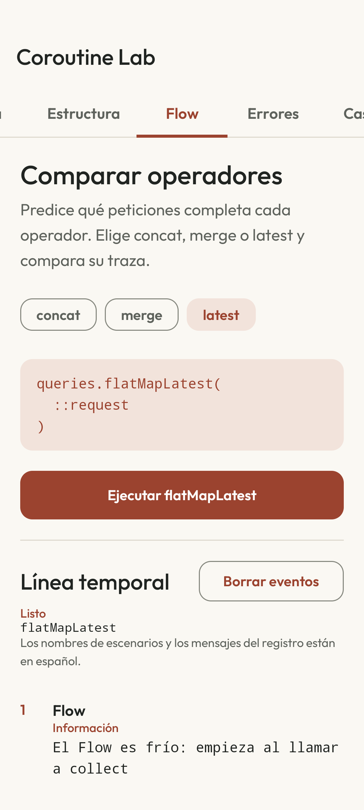

# Coroutine Lab

[English](README.md) · [CI](https://github.com/navalcode/coroutine-lab/actions/workflows/checks.yml)

Aplicación Android para comparar Kotlin Coroutines y Flow. Ejecuta peticiones ficticias de viajes y consulta su orden, resultados, cancelación y errores en un registro de eventos. No necesita cuenta ni servicios externos.



## Qué puedes probar

1. En **Flow**, selecciona concat, merge o latest y ejecútalo. Compara qué peticiones terminan y en qué orden.
2. En **Estructura**, inicia trabajo cancelable. Cambia a Guía y pulsa **Cancelar** en la barra: el ViewModel sigue manteniendo la tarea.
3. En **Errores**, compara captura local, async/await, CoroutineExceptionHandler y supervisorScope. Los fallos previstos quedan registrados sin cerrar la app.
4. En **Casos**, simula escritura rápida y compara cargas secuenciales y paralelas. Los tiempos corresponden a esa ejecución ficticia, sin acreditar rendimiento de producción.
5. **Borrar eventos** limpia el registro cuando termina el trabajo. No cancela una tarea.

## Compilar y ejecutar

Usa JDK 17, Android SDK 36 y API 26 o superior para instalar. Abre el proyecto en Android Studio o configura el SDK en un `local.properties` sin seguimiento. Desde este directorio:

```sh
./gradlew :app:testDebugUnitTest :app:lintDebug :app:assembleDebug
./gradlew :app:installDebug
```

El wrapper de Gradle 8.13 verifica el SHA-256 de su distribución. Las dependencias están fijadas en `gradle/libs.versions.toml`. Las reglas de idioma de los tests nativos requieren API 33+; sustituye `DEVICE_ID` por un serial concreto:

```sh
ANDROID_SERIAL=DEVICE_ID ./gradlew :app:connectedDebugAndroidTest
```

## Leer el código

- [CoroutineExamples.kt](app/src/main/java/com/example/coroutinelab/domain/CoroutineExamples.kt): tareas estructuradas, operadores Flow, errores y dos casos de refactorización.
- [CoroutineLabViewModel.kt](app/src/main/java/com/example/coroutinelab/CoroutineLabViewModel.kt): ciclo de vida del escenario, selección de estrategia y cancelación.
- [FakeTravelRepository.kt](app/src/main/java/com/example/coroutinelab/data/FakeTravelRepository.kt): datos ficticios y dispatcher inyectable.
- [ScenarioJourneyTest.kt](app/src/androidTest/java/com/example/coroutinelab/ui/ScenarioJourneyTest.kt): actividad real, cancelación desde Guía, recreación, orden de eventos y manejador raíz.

Los tests del dominio usan tiempo virtual. Compose recoge el estado con `collectAsStateWithLifecycle`; `viewModelScope` mantiene los Jobs. Los nombres de escenarios, mensajes del registro y ejercicios detallados están en español; la interfaz lo indica. El registro no inventa timestamps.

Guías detalladas en español:

- [Guia didactica](docs/01_GUIA_DIDACTICA.md)
- [Launch async excepciones](docs/02_LAUNCH_ASYNC_EXCEPCIONES.md)
- [Refactorizaciones](docs/03_REFACTORIZACIONES.md)
- [Material para compartir](docs/04_MATERIAL_PARA_COMPARTIR.md)
- [Ejercicios](docs/05_EJERCICIOS.md)

## Comprobaciones y límites

La suite contiene **10 tests JVM y 4 nativos**. [Verificación](docs/VERIFICATION.md), en inglés, recoge las ejecuciones, capturas, avisos de auditoría y la diferencia entre cobertura nativa local y CI. [DESIGN.md](DESIGN.md) explica la interfaz.

Hay recursos españoles con inglés de respaldo. No se atribuye validación física, certificación de accesibilidad, release optimizada ni publicación en tiendas. Se conservan licencias y atribuciones de fuentes/dependencias en [avisos de terceros](THIRD_PARTY.md).
