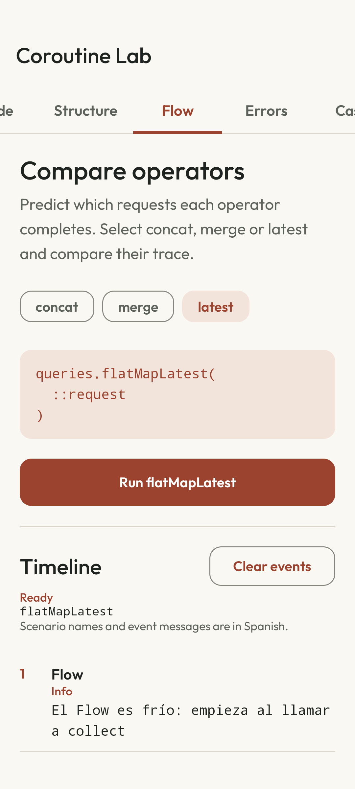

# Coroutine Lab

[Español](README.es.md) · [CI](https://github.com/navalcode/coroutine-lab/actions/workflows/checks.yml)

An Android app for comparing Kotlin Coroutines and Flow. Run fictional travel requests and inspect their order, results, cancellation and errors in an event log. No account or external service is needed.



## Try it

1. In **Flow**, select concat, merge or latest and run it. Compare which requests finish and in what order.
2. In **Structure**, start cancellable work. Switch to Guide and select **Cancel** in the toolbar; the ViewModel still owns the running job.
3. In **Errors**, compare local catch, async/await, CoroutineExceptionHandler and supervisorScope. Expected failures are recorded without closing the app.
4. In **Cases**, simulate typing and compare sequential/parallel loading. Timings describe this fictional run, not a production benchmark.
5. **Clear events** removes the log after work stops. It does not cancel work.

## Build and run

Use JDK 17, Android SDK 36 and API 26+ for installation. Open the project in Android Studio or configure the SDK in an untracked `local.properties`. From this directory:

```sh
./gradlew :app:testDebugUnitTest :app:lintDebug :app:assembleDebug
./gradlew :app:installDebug
```

The Gradle 8.13 wrapper verifies its distribution SHA-256. Dependencies are pinned in `gradle/libs.versions.toml`. Native test locale rules require API 33+; replace `DEVICE_ID` with an explicit serial:

```sh
ANDROID_SERIAL=DEVICE_ID ./gradlew :app:connectedDebugAndroidTest
```

## Read the code

- [CoroutineExamples.kt](app/src/main/java/com/example/coroutinelab/domain/CoroutineExamples.kt): structured tasks, Flow strategies, error handling and the two refactoring cases.
- [CoroutineLabViewModel.kt](app/src/main/java/com/example/coroutinelab/CoroutineLabViewModel.kt): scenario ownership, strategy selection and cancellation.
- [FakeTravelRepository.kt](app/src/main/java/com/example/coroutinelab/data/FakeTravelRepository.kt): fictional data and injectable dispatcher.
- [ScenarioJourneyTest.kt](app/src/androidTest/java/com/example/coroutinelab/ui/ScenarioJourneyTest.kt): real activity, cancellation from Guide, recreation, ordered events and root-handler resilience.

Domain tests use virtual time. Compose collects state with `collectAsStateWithLifecycle`; `viewModelScope` owns the jobs. Raw scenario names/event messages and the detailed exercises remain in Spanish; the interface identifies this. There are no generated timestamps in the event log.

Detailed Spanish guides:

- [Guia didactica](docs/01_GUIA_DIDACTICA.md)
- [Launch async excepciones](docs/02_LAUNCH_ASYNC_EXCEPCIONES.md)
- [Refactorizaciones](docs/03_REFACTORIZACIONES.md)
- [Material para compartir](docs/04_MATERIAL_PARA_COMPARTIR.md)
- [Ejercicios](docs/05_EJERCICIOS.md)

## Checks and limits

The suite contains **10 JVM tests and 4 native tests**. [Verification](docs/VERIFICATION.md) records dated runs, screenshots, audit warnings and the difference between local native coverage and hosted CI. [DESIGN.md](DESIGN.md) explains the interface.

Spanish resources have an English fallback. No physical-device, formal accessibility, optimized-release or store result is claimed. Existing licenses and font/dependency attribution remain in [third-party notices](THIRD_PARTY.md).
